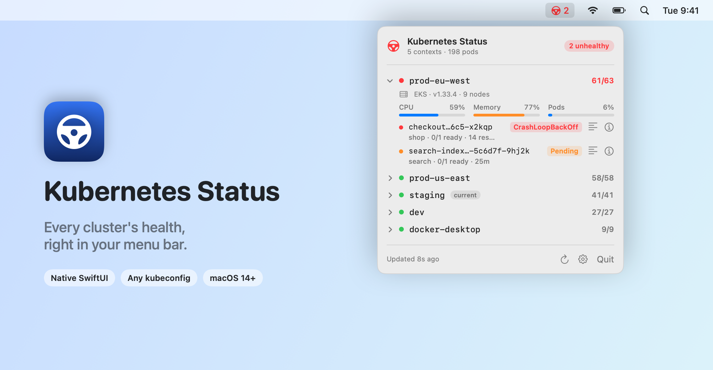
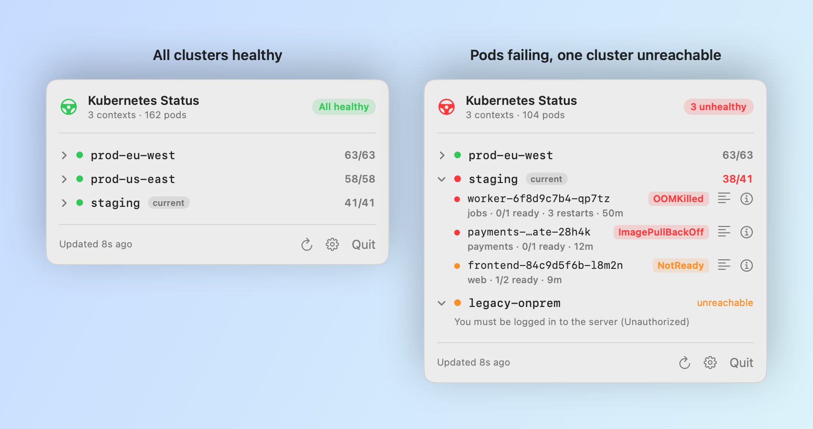
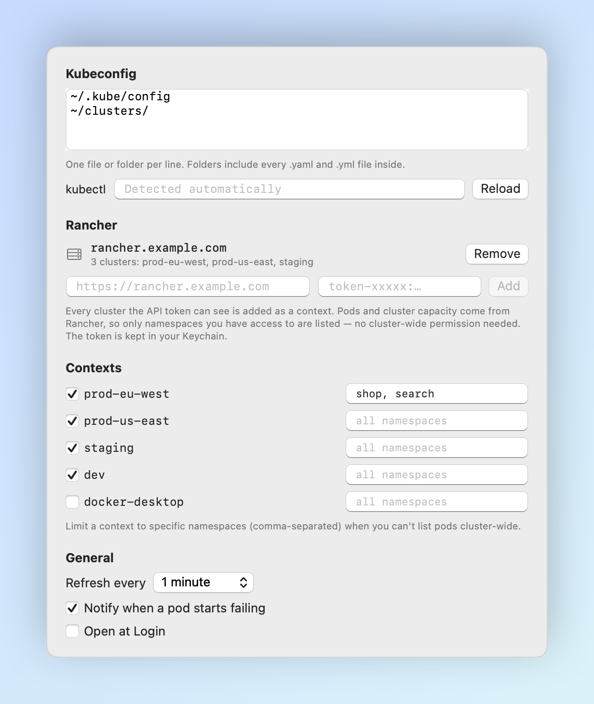
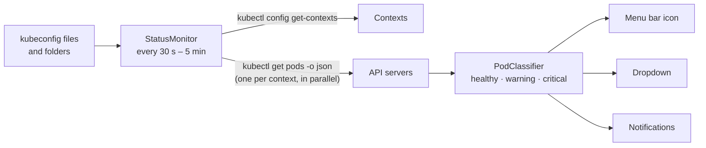

<div align="center">


# Kubernetes Status

**Every cluster's health, right in your macOS menu bar.**

[](https://github.com/recepysl/kubernetes-status/actions/workflows/ci.yml)
[](https://github.com/recepysl/kubernetes-status/releases/latest)


[](LICENSE)

[**Download**](https://github.com/recepysl/kubernetes-status/releases/latest) ·
[Features](#-features) ·
[How it works](#-how-it-works) ·
[Build from source](#-build-from-source) ·
[Architecture](docs/ARCHITECTURE.md)

<br>

<picture>
  <source media="(prefers-color-scheme: dark)" srcset="docs/images/hero-dark.png">
  
</picture>

</div>

## Why

A pod has been crash-looping in staging for an hour, and you find out when someone asks why the demo is broken. Dashboards exist, but they live in a browser tab you closed, and `kubectl get pods -A | grep -v Running` across six contexts is not a habit anyone keeps.

**Kubernetes Status** watches every context in your kubeconfig and puts the answer in the menu bar: a ship's wheel that stays green while everything is fine, and turns red with a count the moment something isn't.

## ✨ Features

|   |   |
| --- | --- |
| 🛞 **One glance, every cluster** | All contexts from all your kubeconfig files, polled in parallel. The menu bar shows the number of unhealthy pods, colored by the worst one. |
| 🩺 **Knows what "unhealthy" means** | `CrashLoopBackOff`, `ImagePullBackOff`, `OOMKilled`, `CreateContainerConfigError` and friends are critical; pods stuck `Pending` or `NotReady` past a 5‑minute grace period are warnings; completed jobs and fresh rollouts are left alone. |
| 🔍 **Straight to the problem** | Clusters with problems open automatically. Each failing pod shows its namespace, ready count, restarts and age — one click follows its **logs** or runs **describe** in Terminal. |
| 🔔 **Notifications** | A native notification the moment a pod starts failing — not on every poll, and not for problems that were already there when you launched the app. |
| 🔐 **Every auth method, for free** | Uses your own `kubectl`, so tokens, client certificates and exec plugins (EKS, GKE, AKS `kubelogin`, Rancher, OIDC) all just work. |
| 🧭 **Namespace-scoped access** | No cluster-wide permission? Limit a context to the namespaces you can see. Forbidden cluster-wide listings automatically fall back to the context's namespace. |
| 🗂 **Folders of kubeconfigs** | Point it at `~/.kube/config`, a list of files, or a whole folder of `*.yaml` — they're merged just like `KUBECONFIG` does. |
| 🪶 **Tiny & native** | ~1.8k lines of Swift, zero dependencies, no Dock icon, no Electron, no in-cluster agent. |

## 🎨 At a glance

The menu bar icon tells you the state of the world — all healthy, a cluster unreachable, or the number of failing pods:

<picture>
  <source media="(prefers-color-scheme: dark)" srcset="docs/images/menubar-dark.png">
  
</picture>

Open it for the details:

<picture>
  <source media="(prefers-color-scheme: dark)" srcset="docs/images/states-dark.png">
  
</picture>

Choose which contexts to watch and how:

<picture>
  <source media="(prefers-color-scheme: dark)" srcset="docs/images/settings-dark.png">
  
</picture>

> Every screenshot in this README is rendered by the app itself from demo data — run `make screenshots` to regenerate them.

## 📦 Install

**Requirements:** macOS 14 Sonoma or later and [`kubectl`](https://kubernetes.io/docs/tasks/tools/install-kubectl-macos/) (`brew install kubectl`).

1. Download the latest **`KubernetesStatus-x.y.z.dmg`** from [Releases](https://github.com/recepysl/kubernetes-status/releases/latest).
2. Open it and drag **Kubernetes Status** onto **Applications**.
3. Launch it — the wheel appears in your menu bar and starts checking `~/.kube/config`.

> [!IMPORTANT]
> Builds are **ad-hoc signed and not notarized**, so Gatekeeper blocks the first launch. Right-click the app → **Open**, or run:
> ```bash
> xattr -dr com.apple.quarantine /Applications/KubernetesStatus.app
> ```

To remove it later: `make uninstall` (or run [`scripts/uninstall.sh`](scripts/uninstall.sh)).

## 🔍 How it works



| Step | Detail |
| --- | --- |
| Find `kubectl` | Homebrew, `/usr/local/bin`, Rancher Desktop (`~/.rd/bin`), `~/.local/bin`, your `PATH` — or a path you set |
| Load kubeconfigs | Files and folders from Settings, joined into `KUBECONFIG` exactly like the CLI does |
| List pods | `kubectl --context <name> get pods --all-namespaces -o json` (or per namespace), 20 s timeout per call |
| Classify | Phase, container states, readiness, restarts and age decide each pod's severity |
| Fall back | A *Forbidden* cluster-wide listing retries in the context's own namespace |

The app only ever **reads**. It runs `get`, `logs` and `describe` — nothing that changes your clusters. More detail in [docs/ARCHITECTURE.md](docs/ARCHITECTURE.md).

## 🛠 Build from source

```bash
git clone https://github.com/recepysl/kubernetes-status.git
cd kubernetes-status
make install        # build KubernetesStatus.app, copy it to /Applications and launch it
```

| Command | What it does |
| --- | --- |
| `make app` | Build `KubernetesStatus.app` in the repo (release build, ad-hoc signed) |
| `make run` | Build and launch it from the repo |
| `make dmg` | Build a drag-to-Applications disk image in `dist/` |
| `make install` / `make uninstall` | Install to or remove from `/Applications` |
| `make once` | Print the health of every watched context and exit |
| `make selftest` | Classification and parsing assertions — no Xcode needed |
| `make test` | The same assertions through XCTest (needs Xcode) |
| `make screenshots` | Re-render the README images from demo data |

The binary doubles as a small CLI — handy in scripts or a shell prompt:

| Flag | Purpose | Exit codes |
| --- | --- | --- |
| `--once [--kubeconfig <file or folder>]` | Print every watched context and its failing pods | `0` all healthy · `1` problems found · `2` setup error |
| `--selftest` | Run the built-in assertions | `0` pass · `1` fail |
| `--render-screenshots <dir>` | Render the demo screenshots | `0` ok · `1` failed |

```console
$ KubernetesStatus --once
✓ prod-eu-west  63/63 healthy
✗ staging  38/41 healthy
    jobs/worker-6f8d9c7b4-qp7tz  OOMKilled  restarts=3
    payments/payments-db-migrate-28h4k  ImagePullBackOff
    web/frontend-84c9d5f6b-l8m2n  NotReady
⚠ legacy-onprem  unreachable — You must be logged in to the server (Unauthorized)
```

### Project layout

```
Sources/
  KubeStatusKit/       kubectl runner, kubeconfig resolution, pod classification — no UI, fully testable
  KubernetesStatus/    SwiftUI menu bar app, settings, notifications, CLI modes, screenshot renderer
Tests/                 XCTest target (delegates to KubeStatusKit.SelfCheck)
Resources/             Info.plist (LSUIElement bundle metadata)
scripts/               build · make-dmg · test · uninstall
tools/                 App icon generator
docs/                  Architecture notes and README images
```

## 🗺 Roadmap

- [ ] Deployment / StatefulSet rollout status alongside pods
- [ ] Per-context colors and custom display names
- [ ] Notarized builds and a Homebrew cask
- [ ] Optional native API client (no `kubectl` needed) for token and certificate auth

Ideas and pull requests are welcome — see [CONTRIBUTING.md](CONTRIBUTING.md).

## ⚖️ Disclaimer

This is an independent, community project. It is not affiliated with or endorsed by the Cloud Native Computing Foundation or the Kubernetes project. Kubernetes is a registered trademark of The Linux Foundation.

## License

[MIT](LICENSE) © 2026 Recep Yesil
