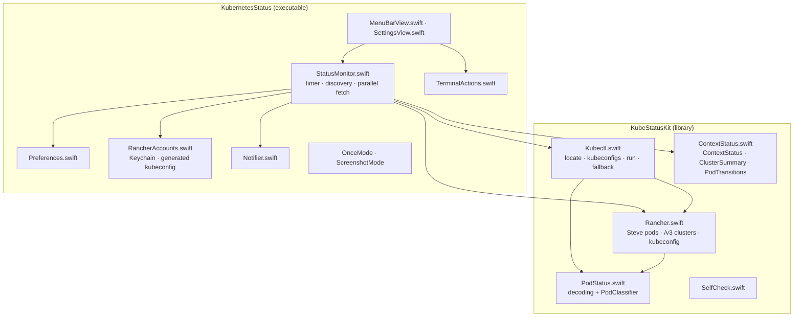

# Architecture

This document is the technical companion to the [README](../README.md): how the app talks to clusters, how it decides what is unhealthy, and the decisions that keep it small.

## Overview

Kubernetes Status is a native macOS menu bar app (SwiftUI `MenuBarExtra`). It discovers every context in the configured kubeconfig files, lists the pods of each watched context on a timer, classifies them, and shows the result in the menu bar, a dropdown and notifications.

- **Bundle identifier:** `io.github.recepysl.kubernetes-status`
- **Target:** macOS 14+
- **Build system:** Swift Package Manager only — no Xcode project
- **Runtime dependency:** `kubectl`

## Why `kubectl` instead of an API client

Authentication is the hard part of talking to Kubernetes: bearer tokens, client certificates, and especially exec credential plugins (`aws eks get-token`, `gke-gcloud-auth-plugin`, `kubelogin`, Rancher, OIDC helpers). Delegating to the user's own `kubectl` means every one of those works exactly as it does in the terminal, with zero auth code in the app. The cost is one subprocess per context per poll, which is negligible at a 30‑second-or-slower cadence.

## Talking to clusters

### Locating `kubectl`

`Kubectl.locate(override:)` uses the path from Settings if one is set; otherwise it checks `/opt/homebrew/bin`, `/usr/local/bin`, `~/.rd/bin` (Rancher Desktop), `~/.local/bin`, `~/bin`, `/usr/bin`, `/bin` and then the process `PATH`. Apps launched from Finder don't inherit a shell `PATH`, so the same directories are also prepended to the subprocess environment — exec plugins such as `aws` or `kubelogin` are found the same way.

### Kubeconfig resolution

Settings holds one entry per line. `Kubectl.resolveKubeconfigs(_:)` expands `~`, keeps existing files, expands folders to their `*.yaml` / `*.yml` / `config` files (sorted), and removes duplicates. The result is passed to `kubectl` as `KUBECONFIG`, so merging behaves exactly like the CLI. With no saved setting, the app starts from `$KUBECONFIG` if present, otherwise `~/.kube/config`.

### Commands

| Purpose | Command |
| --- | --- |
| Discover contexts | `kubectl config get-contexts -o name` |
| Current context | `kubectl config current-context` |
| Pods, cluster-wide | `kubectl --context <ctx> get pods --all-namespaces --output json` |
| Pods, scoped | `kubectl --context <ctx> get pods --namespace <ns> --output json` (once per namespace) |
| Fallback namespace | `kubectl config view --output jsonpath={.contexts[?(@.name=="<ctx>")].context.namespace}` |

Every call gets `--request-timeout=20s`, stdin is `/dev/null` (so a plugin can never hang waiting for input), and a watchdog terminates the process five seconds after the timeout. Standard error is drained on a separate thread to avoid pipe deadlocks.

When a cluster-wide listing fails with *Forbidden* and no namespaces are configured, the app retries in the context's default namespace. Users with access to a few namespaces can list them per context in Settings.

Errors are reduced to one readable line: the last non-empty line of standard error that isn't client-go `memcache.go` noise, without the `error:` prefix, capped at 240 characters.

## Rancher

Rancher-managed clusters often grant access per project rather than cluster-wide, so `kubectl get pods --all-namespaces` is *Forbidden* even though the user can see most namespaces. The app handles them natively:

- **Detection.** `Kubectl.rancherEndpoints()` reads the merged config (`kubectl config view --raw --output json`). A context whose server ends in `/k8s/clusters/<id>` and whose user has a bearer token is treated as Rancher.
- **Pods.** `RancherClient.pods(clusterID:)` calls Rancher's Steve API, `GET <rancher>/k8s/clusters/<id>/v1/pods`. Steve filters by the token's permissions, so the result is exactly the pods the user can see. Its items are standard pod objects, classified by the same `PodClassifier`. Pagination links are followed.
- **Cluster details.** `GET <rancher>/v3/clusters/<id>` provides provider, Kubernetes version, node count, state and `requested` / `allocatable` CPU, memory and pods. Quantities such as `15820m` or `127520412Ki` are parsed by `Quantity`. Clusters that don't report requests show no meters rather than a misleading 0%.
- **Rancher accounts.** In Settings the user adds a Rancher URL and API token. The token is verified against `/v3/clusters` and stored in the Keychain. On every refresh the app lists the clusters and writes `~/Library/Application Support/<bundle id>/rancher/<host>.yaml` (mode `0600`, folder `0700`), one context per cluster, which is appended to `KUBECONFIG`. Detection then picks those contexts up like any other, and *Logs* / *Describe* work in Terminal through the same file.

Namespace filters still apply to Rancher contexts and are matched against the returned pods.

## Classification

`PodClassifier` turns each item of `kubectl get pods -o json` into a `PodStatus` with a `Severity`:

| Situation | Severity | Reason shown |
| --- | --- | --- |
| Being deleted (`deletionTimestamp` set) | skipped | — |
| `Succeeded` | healthy | `Completed` |
| `Failed`, owned by a Job, or `Evicted` | warning | pod or container reason |
| `Failed`, otherwise | critical | pod or container reason |
| A container or init container waiting/terminated with `CrashLoopBackOff`, `ImagePullBackOff`, `ErrImagePull`, `InvalidImageName`, `CreateContainerConfigError`, `CreateContainerError`, `RunContainerError`, `OOMKilled`, `Error`, `ContainerCannotRun` or `DeadlineExceeded` | critical | that reason |
| `Running` with every container ready | healthy | `Running` |
| Anything else (`Pending`, `ContainerCreating`, `NotReady`, …) younger than 5 minutes | healthy | the reason |
| Anything else, older | warning | the reason |

A context's severity is its worst pod's, or *warning* if it couldn't be reached. Unhealthy pods are sorted by severity, then by namespace and name.

## Code structure

### `StatusMonitor`

- Runs on the main actor and publishes contexts, statuses, setup errors and the last update time.
- Each tick discovers contexts, then fetches every watched context concurrently in a `TaskGroup`; each blocking `kubectl` call runs on a global dispatch queue.
- A generation counter discards results from a tick that was overtaken by a newer one.
- Contexts with problems expand automatically unless the user has toggled them by hand.
- The timer is rescheduled when the refresh interval changes, and a refresh runs as soon as the set of watched contexts changes.

### Notifications

`PodTransitions.newlyFailing(previous:current:)` returns pods that are critical now but weren't in the previous successful snapshot of the same context. Nothing fires on the first snapshot, so launching the app never floods you with already-known problems. Notifications are skipped entirely when the binary runs without an app bundle (e.g. `swift run`).

### Terminal actions

*Logs* and *Describe* open Terminal with the exact command, including `KUBECONFIG` and `--context`, so what you see in the menu is reproducible in the shell. Arguments are single-quoted for the shell and escaped for AppleScript.

## Packaging and signing

- `scripts/build.sh` builds in release mode, generates the icon if needed, assembles `KubernetesStatus.app` and signs it ad hoc.
- `scripts/make-dmg.sh` packages `dist/KubernetesStatus-<version>.dmg`.
- `.github/workflows/release.yml` publishes the DMG and a zipped app when a `v*` tag matching `Info.plist` is pushed, using the matching CHANGELOG section as release notes.

Builds are not notarized; see the README for the Gatekeeper workaround.

## Testing

`SelfCheck.run()` covers classification for every row of the table above, sorting, counts, transitions, error summarising and kubeconfig folder expansion. It runs via `--selftest` on the Command Line Tools toolchain (which lacks XCTest) and via `swift test` in CI.
